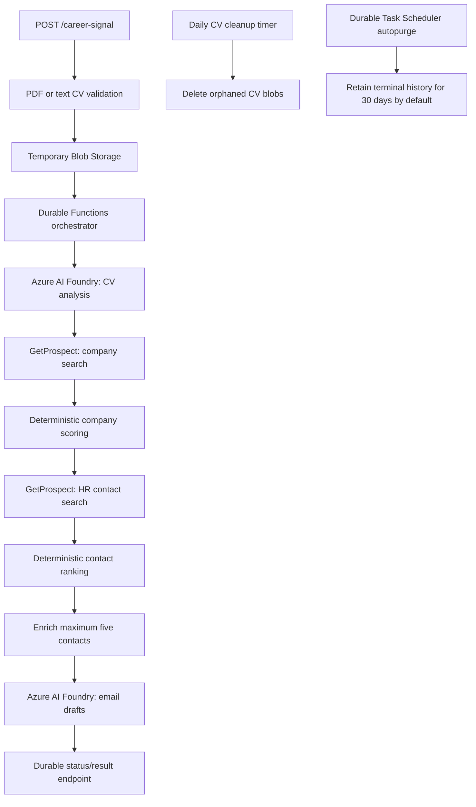

# CareerSignal

## CareerSignal


CareerSignal turns a candidate's CV and search preferences into a short, explainable list of relevant companies and HR / Talent Acquisition contacts, then prepares individual outreach email drafts.

It is a **contact-discovery and outreach-preparation workflow**. It does not discover or verify open vacancies, send emails, guarantee a reply, or guarantee that a company is hiring.

## What the workflow does

1. Accepts a text CV or a text-based PDF (maximum 10 MB; scanned PDFs are not OCR'd).
2. Extracts CV text and stores it temporarily in Azure Blob Storage.
3. Uses Azure AI Foundry to extract evidence-based skills, target roles, search keywords, target countries and gaps.
4. Searches GetProspect for companies and evaluates a bounded set of results against the candidate profile.
5. Searches those companies for HR / Talent Acquisition contacts.
6. Ranks contacts using role relevance, company fit and email availability, and selects no more than five contacts (maximum two per company).
7. Attempts sequential email enrichment for those five contacts only.
8. Generates one individual draft per shortlisted contact. Recipient identity, company name and email are taken from provider data, not invented by the language model.

## Architecture



### Matching model

Company fit is a transparent weighted score: company-search keyword relevance (45%), candidate skills (25%), target roles (15%) and additional matching criteria (15%). Where both the candidate preference and company data contain a country code, the profile score is weighted to reserve up to 15 points for a country match.

Contact fit uses HR role relevance (65%), company fit (30%) and email availability (5%). Non-HR titles are excluded. Contacts below the configured minimum score or from weakly matched companies are excluded. At most two contacts are selected from one company.

These are heuristic ranking scores, not machine-learned probabilities. A score of 90 does not mean a 90% chance of a reply or an interview. Each result includes a score breakdown and match reasons so a user can inspect why it ranked.

## API

### Start a search

`POST /api/career-signal` (Function key required)

PDF upload: `multipart/form-data` with `cv` as a PDF and optional `preferences` as a JSON object.

Text upload:

```json
{
  "cvText": "Plain-text CV content...",
  "preferences": {
    "countryCodes": ["FR", "BE"],
    "targetRoles": ["Cloud / DevOps Engineer"],
    "internshipDuration": "6 months",
    "startDate": "2027-01"
  }
}
```

The response contains Durable Functions status-management URLs. Poll the returned `statusQueryGetUri` until the workflow completes; the completed output contains `analysis`, ranked `companies`, up to five `contacts`, `drafts`, and a summary. Protect the status-management URLs as credentials: do not publish them or write them to analytics/logs.

The API accepts a maximum 10 MB PDF, 100,000 extracted/text CV characters and 10 KB of preferences. Only text-based PDFs are supported; image-only/scanned PDFs return `422` because OCR is not implemented.

### Delete a completed search

`DELETE /api/career-signal/{instanceId}` (Function key required)

This deletes the temporary CV blob, where present, and purges Durable Functions history for a completed, failed, terminated or cancelled instance. A running instance returns `409`; terminate it through the Durable management URL first. The endpoint is protected by a Function key, not per-user authentication. Do not expose the Function key in a public client.

## Configuration

Function App application settings:

| Setting | Purpose |
|---|---|
| `KEY_VAULT_URL` | Key Vault URI |
| `AZURE_CLIENT_ID` | Client ID of the user-assigned managed identity |
| `CV_STORAGE_ACCOUNT_URL` | Blob Storage account endpoint, e.g. `https://<account>.blob.core.windows.net` |
| `CV_CONTAINER_NAME` | Optional; defaults to `candidate-cvs` |
| `FOUNDRY_ENDPOINT` | Azure AI Foundry project/model endpoint base URL used by the Responses API |
| `FOUNDRY_MODEL_DEPLOYMENT` | Model deployment name |
| `DURABLE_TASK_SCHEDULER_CONNECTION_STRING` | Durable Task Scheduler connection string configured in `host.json` |
| `CAREERSIGNAL_CV_ORPHAN_RETENTION_HOURS` | Orphaned CV blob cleanup age; defaults to 48 hours (allowed: 24–720) |
| `CAREERSIGNAL_RETENTION_CRON` | Optional NCRONTAB schedule; defaults to `0 0 3 * * *` (03:00 UTC daily) |

Key Vault secrets (exact names):

- `GetProspectApiKey`
- `FOUNDRY-API-KEY`

The Function App's user-assigned managed identity needs **Key Vault Secrets User** on the vault and **Storage Blob Data Contributor** on the CV container or storage account. `AZURE_CLIENT_ID` must be that identity's client ID. Do not place API keys in source control or ordinary application settings.

## Local development

Requires Node.js 24 or later.

```powershell
npm ci
npm run check
npm test
func start
```

Provide local values through `local.settings.json` (never commit it). The automated unit tests for matching, draft normalization and lazy Key Vault configuration do not call Azure or GetProspect.

## Privacy, security and product limits

- The original PDF is parsed in memory; extracted CV text is uploaded as a temporary blob and deleted after CV analysis. A daily sweep removes orphaned candidate-CV blobs older than the configured threshold.
- Durable Task Scheduler autopurge is enabled by default and retains terminal orchestration history for 30 days. The scheduler retention policy is configured at the scheduler resource, not by a Function App setting; eligible statuses include Completed, Failed, Canceled and Terminated. Any custom policy applies across every task hub on that scheduler. Users may request earlier deletion through the DELETE endpoint.
- CV text is sent to the configured Azure AI Foundry deployment. Company/contact searches and up to five email-enrichment attempts are sent to GetProspect. A privacy notice must disclose these processors before real candidate CVs are used.
- GetProspect email enrichment can consume credits. The implementation caps attempts at five per workflow and runs them sequentially. Review the provider's current credit/rate-limit terms before production use.
- Email drafts are suggestions for human review. CareerSignal does not send messages.
- The current API uses Function-key authorization and does not implement user accounts, tenant isolation, per-user result ownership, consent records, or a user-facing deletion dashboard. It is suitable for a controlled prototype, not a public multi-user launch without an identity/access-control layer.
- The 10 MB PDF size is validated by the function after multipart parsing. On Flex Consumption, `FUNCTIONS_REQUEST_BODY_SIZE_LIMIT` is not used; enforce an ingress-level request cap with an API gateway or equivalent before exposing this endpoint publicly.
- A heuristic match is not evidence of a live vacancy. Verify the company, recipient's current position, email validity and internship availability before contacting anyone.

## Frontend

The Angular application is in [`CareerSignal-Web/`](CareerSignal-Web/README.md). It provides a public product page and candidate workspace with CV selection, preference review, discovery results, and editable outreach drafts. Demo mode is enabled by default and uses fictional data only; it never calls the backend or GetProspect. The PDF selection in demo mode validates the file locally but does not upload or parse it.

Run the frontend locally (Node.js 24+ and npm):

```sh
cd CareerSignal-Web
npm ci
npm start
```

Build it for production with `npm run build`. The output is `CareerSignal-Web/dist/careersignal/browser`.

The live Angular adapter reflects the observed backend submit/status/result contract, but live mode is intentionally disabled. The backend currently uses Function-key authorization and does not provide user sign-in or per-user ownership. Do not put a Function key or Durable management URL in the browser. Before enabling live CV processing, add the authenticated, owner-aware server-side API facade described in [`docs/azure-hosting.md`](docs/azure-hosting.md).

## Frontend hosting

Azure Static Web Apps Free is the recommended host for the public, demo-only frontend. The frontend's deployment workflow and project configuration live under `CareerSignal-Web`; the current workflow expects the Angular app to be the repository root. If deploying this monorepo, configure the workflow's app location and npm working directory for `CareerSignal-Web`, and use `dist/careersignal/browser` as the output location. Keep the deployed site in demo mode until the secure API facade and access controls are in place. Step-by-step architecture and rollout guidance is in [`docs/azure-hosting.md`](docs/azure-hosting.md).

## Backend deployment

GitHub Actions runs `npm ci`, syntax checks and unit tests before packaging the Node.js application for the `hr-function` Azure Function App. Deployment still requires the existing publish-profile secret in the GitHub repository.

The workflow intentionally packages `host.json`, package manifests, `src` and installed production dependencies. Tests and documentation are not shipped in the runtime artifact.
