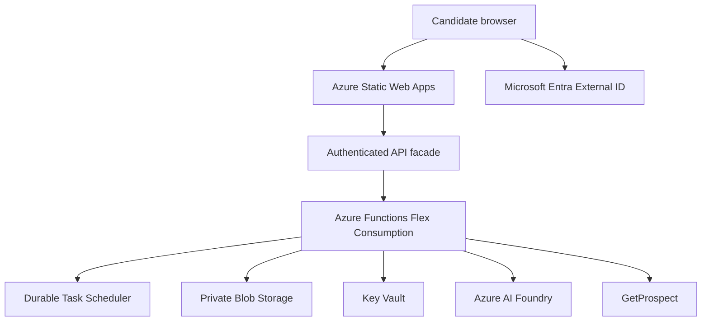

# CareerSignal Azure hosting plan

## Recommendation

Keep the Angular UI static and the existing workflow serverless. Do not move this workload to AKS or host the Angular site inside the Function App.

- **Public demonstration:** Azure Static Web Apps Free, with demo mode enabled and no backend access.
- **Authenticated product:** Keep Static Web Apps as the frontend host. Use the existing Azure Functions Flex Consumption app for the workflow, Durable Task Scheduler for orchestration, Blob Storage for temporary CV text, and Key Vault for provider credentials. Add an authenticated API facade before enabling live requests.
- **Do not deploy or expose live CV processing yet.** The current Function API is Function-key protected only and has no sign-in, user ownership, or per-user authorization. A browser must never receive the Function key or Durable management URLs.

This is the lowest-change fit for the current product. The workflow already uses Azure Functions v4, Node.js 24, Flex Consumption in its GitHub Actions workflow, Azure-managed Durable Task Scheduler, Blob Storage, Key Vault, Azure AI Foundry, and GetProspect.

## Current workflow and host boundaries

The arrows show request/data flow. The candidate browser talks to the authenticated facade, not directly to Function-level endpoints or Durable management URLs. The existing orchestration owns company discovery, contact selection, enrichment, and draft generation.

## Important security work before live use

Add an authenticated facade, either as routes in the current Function App or as a small separate Function App if deployment isolation is needed. Do not expose the existing Function management API directly.

The facade must:

1. Validate Microsoft Entra External ID access tokens and derive the user identity from verified claims.
2. Start a search for the authenticated user and persist the relationship between user ID and orchestration ID.
3. Provide a stable user-facing status route such as `GET /searches/{id}`. Check ownership on every read, cancel, or delete request.
4. Poll Durable Functions server-side. Keep the Durable `statusQueryGetUri` and Function credentials on the server; never return them to Angular, logs, analytics, or error messages.
5. Enforce per-user rate limits, upload/request limits, consent, and deletion behavior.
6. Return only the typed analysis, company, contact, and draft data the user is authorized to see.

Use exact-origin CORS for the production frontend domain. Keep the Function App restricted to the facade where feasible. Put any Function credential required between the facade and current workflow in Key Vault or secure Function settings, accessed through managed identity. Never put it in Angular environment files.

## Azure services and responsibilities

| Part | Hosting | Notes |
|---|---|---|
| Angular frontend | Azure Static Web Apps | Free plan for the public demo. Keep `CAREERSIGNAL_MODE=demo` in the build. For authenticated production, use a plan that supports the chosen production authentication and deployment requirements; confirm current feature availability before selection. |
| Authenticated API facade | Azure Functions | Validates user identity, enforces ownership, hides Durable management URLs, and proxies status/results. Reuse the current Function App initially to reduce services, unless a separate security/deployment boundary justifies another app. |
| CareerSignal workflow | Existing Azure Functions Flex Consumption | Continue using Node.js 24 and Functions programming model v4. Flex Consumption is already selected by the backend deployment workflow. |
| Orchestration | Azure Durable Task Scheduler | Keep the existing Azure-managed provider configuration. Treat scheduler history as sensitive candidate data and verify retention settings. |
| Temporary CV text | Private Azure Blob Storage | Use managed identity and least-privilege RBAC. Keep the existing deletion-after-analysis behavior, orphan cleanup timer, and configure storage lifecycle as a secondary safeguard. |
| Secrets | Azure Key Vault | Keep GetProspect and Foundry credentials out of source control, CI logs, and browser bundles. Access through managed identity. |
| Monitoring | Application Insights and Azure Monitor | Record request IDs, stage durations, failures, and dependency health. Scrub CV text, contact addresses, draft content, and Durable management URLs. |
| AI/contact providers | Azure AI Foundry and GetProspect | External service dependencies, not Azure-hosted application components. Confirm region, privacy terms, rate limits, and data-processing agreements. |

Avoid AKS, a custom VM, and a database just for the current demo. Add a database only if the facade needs durable user-to-search ownership and retention records that cannot be safely represented with the existing storage approach; choose the store after confirming query, retention, and audit requirements.

## Hosting alternatives

| Option | Fit | Trade-off |
|---|---|---|
| Static Web Apps Free + demo data | Best for portfolio/public demonstration | Lowest cost and operational work. No live CV processing. This is the current safe state. |
| Static Web Apps + authenticated facade + existing Functions | Recommended production path | Keeps static delivery inexpensive and reuses the current serverless workflow. Requires authentication, ownership mapping, server-side status proxying, and secure ingress before release. |
| App Service hosting Angular and a Node.js BFF | Plausible alternative | One web deployment can serve UI and BFF from one origin, reducing browser CORS work. Costs more than static hosting and adds a continuously managed web app; does not remove the need for user authorization in the workflow. |
| Container Apps or AKS | Not recommended now | Adds container/platform operations without a current requirement for custom runtimes, sustained workloads, or independent service scaling. Revisit only when measured constraints justify it. |

## Deployment and environments

Use separate development and production resource configurations. Do not share production CV storage, Durable Task Scheduler, Key Vault, or provider credentials with local/demo environments.

- **Frontend:** Keep a separate frontend repository. Its current workflow assumes the Angular project is the repository root and builds `dist/careersignal/browser`. If it remains nested inside the backend repository, adjust GitHub Actions `app_location` and npm working directory; do not deploy the backend repository root as the Static Web App.
- **Backend:** The existing workflow builds and tests the Function App, then deploys to `hr-function` using a publish-profile secret. Replace publish-profile authentication with GitHub Actions OIDC and Azure federated credentials before production use. Keep build/test and deploy stages separate, and deploy only from the protected main branch or an approved release.
- **Secrets:** Store `AZURE_STATIC_WEB_APPS_API_TOKEN` in the frontend GitHub Actions environment for deployment only. It is not an Angular runtime secret. Use environment-scoped secrets and approvals for production deployments.
- **Configuration:** Set demo/live mode at build or server-side configuration, not from a user-editable browser storage value. The production public demo must remain demo-only until the facade and security controls are deployed.
- **Custom domains:** Use a frontend domain such as `app.example.com` and an API domain such as `api.example.com`, or route both through one gateway. Configure TLS and exact-origin CORS.

## Rollout plan

1. **Demo hosting:** Push the frontend as its own GitHub repository. Create Azure Static Web Apps Free in the Azure Portal and add its deployment token as a GitHub Actions secret. Verify the deployed build remains in demo mode and never calls the backend.
2. **Identity and facade:** Select the identity model, implement sign-in, user-to-search ownership, authenticated status/results/deletion routes, and rate limits. Do not forward Durable management URLs to the browser.
3. **Private backend path:** Configure Function App ingress, managed identity, Key Vault and Blob RBAC, request-size limit, CORS, and provider egress. Use a non-production resource group and test the complete workflow with fictitious CV data.
4. **Operations:** Configure retention, data deletion tests, dependency alerts, structured PII-safe telemetry, error alerts, and rollback. Verify provider terms and candidate privacy disclosures before handling real CVs.
5. **Enable live frontend:** Add the authenticated gateway URL to frontend deployment configuration only after end-to-end security and ownership tests pass. Never add Function keys to Angular.

## Release checks

Before enabling live traffic, verify:

- An unauthenticated request cannot start or inspect a search.
- A user cannot read, poll, or delete another user's orchestration.
- Function keys and Durable management URLs never reach the browser.
- Uploaded PDFs meet the 10 MB ingress limit, and scanned/image-only PDFs fail clearly.
- CV blobs and orchestration history follow the documented retention policy; user deletion is tested.
- Failure and timeout paths do not leave CV text behind or expose sensitive provider errors.
- Email addresses are labeled according to provider status, and drafts remain user-reviewed. The service must not send email.
- Demo mode remains isolated from Azure Functions and GetProspect.

## Decision

Keep the current static-frontend/serverless-workflow structure. Use Static Web Apps Free for the public demo and retain Flex Consumption plus Durable Task Scheduler for the backend. Add identity and an owner-aware API facade before any public live processing. Revisit the hosting plan if measured traffic, identity requirements, networking controls, or operational targets exceed these services' capabilities.
