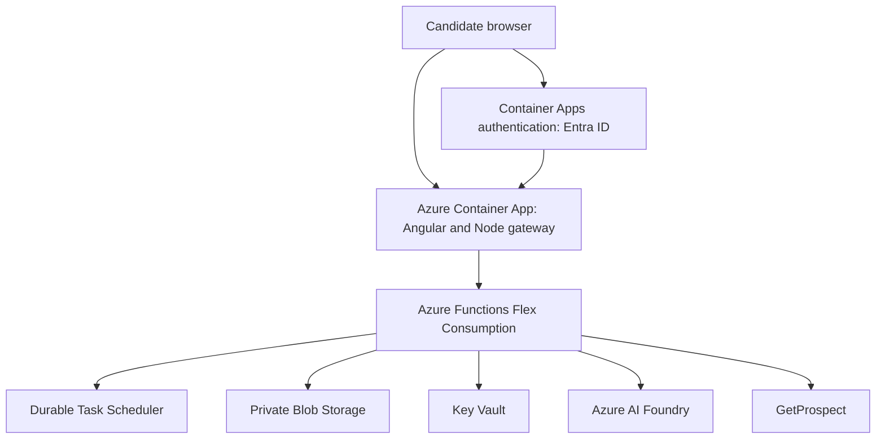

# CareerSignal Azure hosting plan

## Recommendation

Keep the Angular UI static and the existing workflow serverless. Do not move this workload to AKS or host the Angular site inside the Function App.

- **Single application host:** One Azure Container App serves the Angular frontend and a same-origin Node.js gateway. The gateway proxies authorized live requests to the existing Azure Functions workflow.
- **Public demonstration and restricted live workflow:** The Angular demo remains publicly accessible with fictional data. Azure Container Apps built-in Microsoft Entra authentication supplies the identity for live requests, which the gateway restricts to one allowlisted email. Durable Task Scheduler, Blob Storage, Key Vault, Azure AI Foundry, and GetProspect remain on Azure.
- **Public multi-user processing is not enabled.** The Azure API itself uses Function-key authorization and has no general user accounts or ownership mapping. The Worker currently restricts live requests to one allowlisted Access identity; never expose the Function key or Durable management URLs to the browser.

This keeps the existing Azure workflow and places the frontend and gateway together in the Container App. Azure Static Web Apps creation was blocked by the subscription's region-eligibility policy; the Container Apps region must still be checked for availability and cost.

## Current workflow and host boundaries

The browser talks to the Container App. Its Node gateway checks the authenticated Entra principal and the single-email allowlist, then sends Azure requests with `x-functions-key` set server-side. The gateway encrypts the Durable status URL into a short-lived, owner-bound handle and polls it server-side. The browser never receives the Azure key or raw management URL. The existing orchestration owns company discovery, contact selection, enrichment, and draft generation.

## Additional security work before public multi-user use

The current gateway is a restricted single-operator integration, not a general account system. Before allowing other candidates to process CVs:

1. Replace the single-email allowlist with a supported user identity flow and enforce authorization for every search.
2. Persist user-to-search ownership and retention records server-side. The current short-lived encrypted handle is suitable only for the restricted test workflow.
3. Add reliable per-user/global abuse limits and controls for GetProspect credit consumption. The current Cloudflare rate-limit binding is approximate and location-scoped.
4. Provide consent, privacy disclosure, and user-facing deletion for CV-derived results and orchestration history.
5. Keep Function ingress limited to the gateway where feasible, retain Key Vault and Blob least-privilege access, and scrub CVs, email addresses, drafts, keys, and Durable URLs from telemetry.

The frontend and gateway use the same origin, so browser-to-gateway CORS is not needed. Never put Function credentials or Durable management URLs in Angular environment files.

## Azure services and responsibilities

| Part | Hosting | Notes |
|---|---|---|
| Angular frontend and gateway | Azure Container App | One image serves `CareerSignal-Web/dist/careersignal/browser` and same-origin `/api/*` routes on port 8080. Keep demo mode public; configure Entra authentication and Container Apps secrets before live testing. |
| Authenticated API gateway | Node.js server in Container App | Checks the platform-authenticated Entra principal and single-operator allowlist, adds the Function key server-side, limits submissions per running process, and proxies Durable status/results without exposing management URLs. |
| CareerSignal workflow | Existing Azure Functions Flex Consumption | Continue using Node.js 24 and Functions programming model v4. Flex Consumption is already selected by the backend deployment workflow. |
| Orchestration | Azure Durable Task Scheduler | Keep the existing Azure-managed provider configuration. Treat scheduler history as sensitive candidate data and verify retention settings. |
| Temporary CV text | Private Azure Blob Storage | Use managed identity and least-privilege RBAC. Keep the existing deletion-after-analysis behavior, orphan cleanup timer, and configure storage lifecycle as a secondary safeguard. |
| Secrets | Azure Key Vault | Keep GetProspect and Foundry credentials out of source control, CI logs, and browser bundles. Access through managed identity. |
| Monitoring | Application Insights and Azure Monitor | Record request IDs, stage durations, failures, and dependency health. Scrub CV text, contact addresses, draft content, and Durable management URLs. |
| AI/contact providers | Azure AI Foundry and GetProspect | External service dependencies, not Azure-hosted application components. Confirm region, privacy terms, rate limits, and data-processing agreements. |

Avoid AKS, a custom VM, and a database just for the current demo. Add a database only if the facade needs durable user-to-search ownership and retention records that cannot be safely represented with the existing storage approach; choose the store after confirming query, retention, and audit requirements.

## Hosting alternatives

| Option | Fit | Trade-off |
|---|---|---|
| Azure Container Apps | Chosen combined frontend and gateway host | One container serves Angular and the Node gateway. Check region availability, supporting-resource cost, and the Student subscription allowance before deployment. |
| Cloudflare Worker + demo data | Alternative public demonstration host | Can serve the Angular assets and fictional demo data separately if Container Apps deployment is unavailable. |
| Azure App Service | Alternative | Can also serve Angular and a Node.js gateway on one origin, but may cost more for an always-running web app. |
| AKS | Not recommended | Adds cluster operations that are not needed for this product. |

## Deployment and environments

Use separate development and production resource configurations. Do not share production CV storage, Durable Task Scheduler, Key Vault, or provider credentials with local/demo environments.

- **Frontend and gateway:** `CareerSignal-Web/Dockerfile` builds Angular and packages the static app with `server.mjs` and `worker.mjs`. GitHub Actions tests and publishes the image to GHCR; deploy it to Container Apps on port 8080.
- **Backend:** The existing workflow builds and tests the Function App, then deploys to `hr-function` using a publish-profile secret. It runs only for backend paths or manual dispatch, so frontend changes do not redeploy Azure Functions. Replace publish-profile authentication with GitHub Actions OIDC and Azure federated credentials before production use.
- **Secrets:** Azure provider secrets remain in Key Vault. The Azure Function key and status-encryption key live only as Container Apps secrets. None belong in Angular or GitHub source.
- **Configuration:** The public app defaults to demo. Live mode requires Entra authentication and a single-operator allowlist. This is not a substitute for a public identity and ownership system.
- **Custom domains:** A single Container App origin serves the app and `/api/*`, so browser requests are same-origin and do not need CORS. Use the Container Apps HTTPS ingress.

## Rollout plan

1. **Container build:** GitHub Actions tests and publishes the Angular-plus-gateway image to GHCR. Deploy the image to the permitted Container Apps region and verify the demo does not call Azure or GetProspect.
2. **Restricted live test:** Configure Container Apps Entra authentication, set the Function and encryption secrets, and verify the gateway identity check, owner-bound handle, and failure handling. Do not forward Durable management URLs to the browser.
3. **Public identity and ownership:** Before opening live search to other users, add a production identity flow, durable user-to-search ownership and retention records, per-user deletion, and stronger abuse controls. The current single-operator gateway is not sufficient for multi-user access.
4. **Private backend path:** Configure Function App ingress, managed identity, Key Vault and Blob RBAC, and request-size limits. Test the complete workflow with fictitious CV data.
5. **Operations:** Configure retention, data deletion tests, dependency alerts, structured PII-safe telemetry, error alerts, and rollback. Verify provider terms and candidate privacy disclosures before handling real CVs.

## Release checks

Before enabling live traffic, verify:

- An unauthenticated request cannot start or inspect a search.
- A user cannot read, poll, or delete another user's orchestration.
- Function keys and Durable management URLs never reach the browser.
- Uploaded PDFs meet the 10 MB ingress limit, and scanned/image-only PDFs fail clearly.
- CV blobs and orchestration history follow the documented retention policy; user deletion is tested.
- Failure and timeout paths do not leave CV text behind or expose sensitive provider errors.
- Email addresses are labeled according to provider status, and drafts remain user-reviewed. The service must not send email.
- Demo mode remains isolated from Azure Functions and GetProspect.

## Decision

Use one Azure Container App for the Angular frontend and Node gateway, with the existing Azure Functions/Durable Task Scheduler workflow unchanged. The public site defaults to fictional demo data; live searches are restricted to one Entra identity. Add general user identity, durable ownership, retention, and deletion controls before opening live processing to other users.
